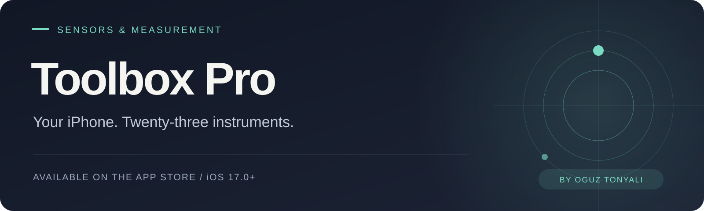
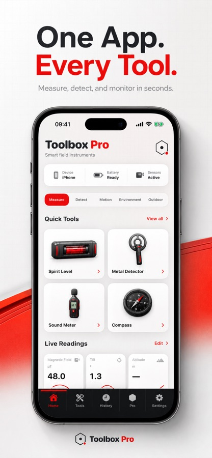
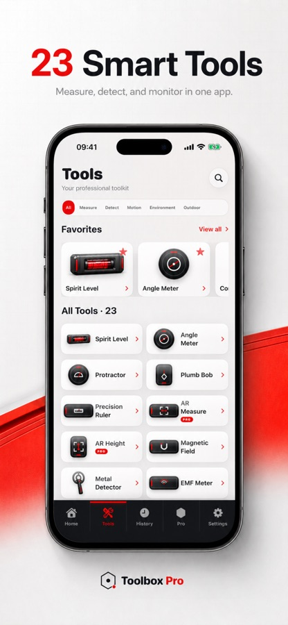
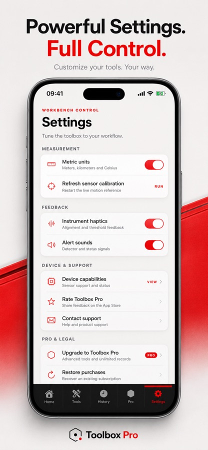

  <a href="https://apps.apple.com/us/app/toolbox-pro-smart-tools/id6806764591"><strong>View on the App Store ↗</strong></a> &nbsp; · &nbsp;
  <a href="docs/ENGINEERING.md">Engineering notes</a> &nbsp; · &nbsp;
  <a href="https://github.com/Zodomik">More by Oğuz Tonyalı</a>

## Toolbox Pro

A native instrument suite that brings measurement, motion, sound and outdoor tools into one interface. Purpose-built gauges turn sensor readings into practical, readable information.

Built and published by **[Oğuz Tonyalı](https://github.com/Zodomik)**. This repository is a public product and engineering showcase; the application source is maintained privately.

## A look inside

  
  
  

*Official product previews from the [App Store listing](https://apps.apple.com/us/app/toolbox-pro-smart-tools/id6806764591).*

## What you can do

- 23 instruments spanning levels, angles, motion and the environment.
- Magnetic field, vibration, sound and frequency views.
- Compass, GPS, speed and distance tools.
- AR measurement, local history and supported data export.

## Technology

| Area | Technologies | Role in the product |
| --- | --- | --- |
| Interface | Swift, SwiftUI | Gauges, charts and instrument-specific surfaces. |
| Motion and location | Core Motion, Core Location, MapKit | Motion, magnetic-field, pressure and location-based instruments. |
| Spatial measurement | ARKit, SceneKit | Camera-based spatial measurement on supported hardware. |
| Audio analysis | AVFoundation, Accelerate | Microphone RMS and zero-crossing frequency estimates. |
| Persistence and access | SwiftData, StoreKit 2, RevenueCat | Local measurement history and Pro access. |

## Implementation notes

SwiftUI sensor app; on-device services; SwiftData measurement history; local CSV/PDF export.

- vDSP RMS measurement and zero-crossing frequency estimation.
- AR raycast endpoints, 3D distance and vertical height difference.
- Rolling vibration RMS and bounded live sample windows.

| Read more | What is covered |
| --- | --- |
| [Architecture and frameworks](docs/ENGINEERING.md) | Runtime components, backend structure and framework responsibilities |
| [Database and local data](docs/DATA_MODEL.md) | Entities, relationships, constraints and persistence choices |
| [Algorithms and implementation choices](docs/ALGORITHMS.md) | Calculations, example flows and the limits of each approach |

## Try the product

**[Open Toolbox Pro on the App Store](https://apps.apple.com/us/app/toolbox-pro-smart-tools/id6806764591)** · Requires iOS 17.0 or later.

Availability and purchase options are shown in the store. For product support, use the developer links on the App Store listing.

---

[All published apps](https://apps.apple.com/us/developer/oguz-tonyali/id1880078720) · [Developer profile](https://github.com/Zodomik) · [Media credits](assets/SOURCES.md)
