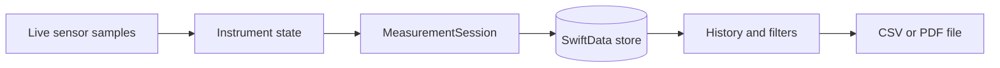

# Toolbox Pro · Local data model

**Persistence framework:** SwiftData. **Main model:** `MeasurementSession`. There is no custom server database. SwiftData owns the local persistence layer; the app does not define a separate PostgreSQL or hand-written SQL schema.

| Field group | Stored data |
| --- | --- |
| Identity | UUID, title and instrument identifier |
| Time | Session timestamp |
| Summary | Minimum, maximum, average and unit |
| User annotations | Notes and favorite flag |
| Samples | Optional Data value containing a JSON-encoded array of numbers |

## Why summaries and samples are separate

The summary fields let history show an instrument, date and min/max/average without decoding the whole sample array. When detail is needed, the model decodes the sample Data back into numbers. An absent/undecodable sample payload becomes an empty array.

The live graph’s recent samples are transient state. Saving a session creates a durable record; it does not turn every individual sensor update into a database row.

## Small preferences

AppStorage/UserDefaults holds settings such as units and interface preferences. Sensor permissions remain system-managed. Purchase entitlement state is managed through the purchase integration, separately from measurement history.

## Export structure

CSV contains the instrument, date, min/max/average, unit and notes. PDF export uses a fixed page size, starts another page when needed and writes session summaries. Both are generated on the device from selected history records.

[Architecture](ENGINEERING.md) · [Calculations](ALGORITHMS.md)
