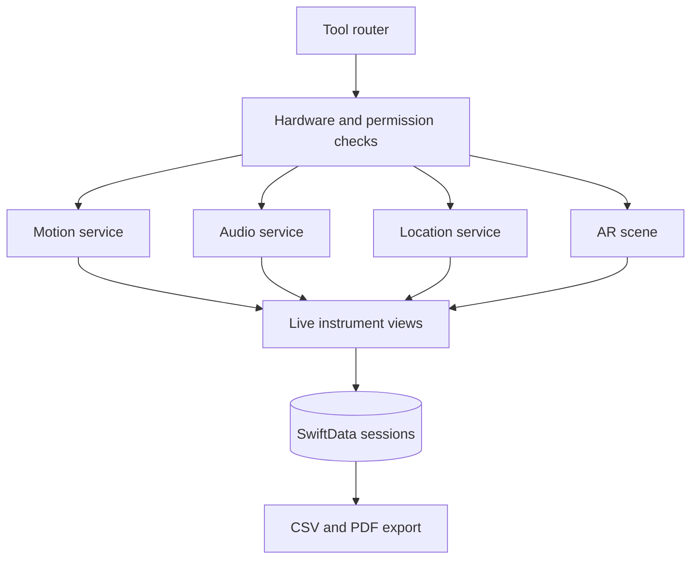

# Toolbox Pro · Architecture

*Implementation notes checked against the working project on 20 November 2026. Store builds may differ as the project evolves.*

Toolbox Pro is a native sensor/instrument app. Measurement processing and history run on the device; it has no custom measurement backend or account database.

| Component | Technology | What it does |
| --- | --- | --- |
| Interface | Swift, SwiftUI | Instrument-specific gauges, graphs, tool routing and history |
| Motion | Core Motion: CMMotionManager, CMAltimeter | Device motion, magnetic vector, attitude, pressure and relative altitude |
| Location | Core Location, MapKit | Coordinates, heading, speed and trip distance |
| Audio | AVFoundation, Accelerate / vDSP | Microphone buffers and RMS measurement |
| Spatial tools | ARKit, SceneKit, SIMD | Surface raycasts, 3D points and measurement markers |
| History | SwiftData | Measurement sessions, summaries, samples and notes |
| Export | Foundation, UIKit / UIGraphicsPDFRenderer | CSV and paginated PDF reports |
| Purchases | RevenueCat, StoreKit 2 | Pro access and restore flow |

## Shared shell, separate sensor services

Motion, location, microphone, torch, purchasing and export each have a service boundary. The UI can share design components while requesting only the capabilities needed by a tool.

Motion updates run on a serial operation queue at a requested 30 Hz. Published UI state is updated on the main actor. Graphs retain a bounded recent sample window, while saved sessions are a separate durable representation.

The audio service taps the input buffer, calculates RMS with vDSP, converts it to a displayed level and estimates frequency from zero crossings. Although Accelerate is imported, this implementation is **not an FFT spectrum analyzer**.

AR tools use `ARWorldTrackingConfiguration`, plane detection and raycasts from the view’s center. SceneKit places endpoint markers and the connecting line. The two-point geometry produces length or a vertical height difference.

## Storage and external services

SwiftData holds local `MeasurementSession` models; small settings use AppStorage/UserDefaults. Export reads those models and creates files locally. RevenueCat/Apple handle purchase access, separate from measurement processing. There is no custom cloud history service in this implementation.

## Measurement interpretation

The audio level uses a fixed offset from digital RMS, and zero crossings are a lightweight frequency estimate. GPS trip filtering is a simple distance-jump rule. These are practical estimates from consumer sensors, not calibrated laboratory measurements. The magnetic instrument measures magnetic field rather than RF/Wi-Fi radiation.

**Code landmarks:** `MotionSensorService`, `AudioMeterService`, `LocationService`, `CapabilityService`, `MeasurementSession`, `ARMeasureRepresentable` and `ExportService`.

**Continue:** [Local data model](DATA_MODEL.md) · [Calculations](ALGORITHMS.md) · [Product](../README.md)
