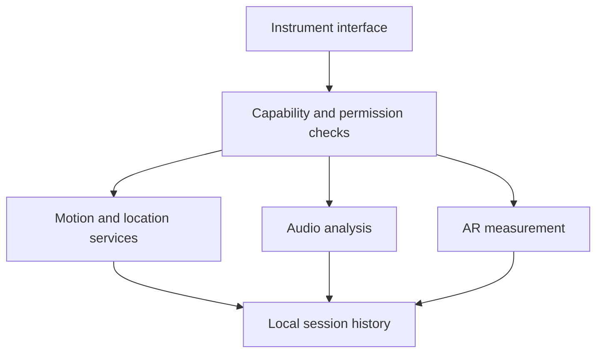

# Toolbox Pro · Engineering notes

This overview describes the product’s implementation at a component level. It accompanies the [product showcase](../README.md).

## Component map

The diagram emphasizes responsibilities and data flow. Platform integrations can have their own independent lifecycle.

## Design decisions

### Capability-aware instruments

Hardware and permission checks sit at the service boundary. Each tool can show an explicit unavailable state when the required device capability is missing.

### One shell, distinct measurement domains

Shared design components give instruments a consistent feel while motion, location, sound and AR services retain their own responsibilities and update lifecycles.

### Useful data beyond the live dial

A structured local session model connects readings to timestamps, notes and history. Persistence is separated from continuously updating sensor streams.

## Stack reference

| Area | Technologies | Responsibility |
| --- | --- | --- |
| Interface | Swift, SwiftUI | Gauges, charts and instrument-specific surfaces. |
| Motion and location | Core Motion, Core Location, MapKit | Motion, magnetic-field, pressure and location-based instruments. |
| Spatial measurement | ARKit, SceneKit | Camera-based spatial measurement on supported hardware. |
| Audio analysis | AVFoundation, Accelerate | Microphone input and frequency-analysis processing. |
| Persistence and access | SwiftData, StoreKit 2, RevenueCat | Local measurement history and Pro access. |

## Scope

The technology summary was checked against the application’s Swift imports, project configuration and relevant service/model implementations. Backend technologies, where listed, were checked against the associated package manifest and database schema. Store screenshots illustrate the released product; the private working project may continue evolving after release.

This documentation publishes no credentials, deployment configuration, private endpoints or application source. Product behavior and supported devices are described in the [current App Store listing](https://apps.apple.com/us/app/toolbox-pro-smart-tools/id6806764591).
